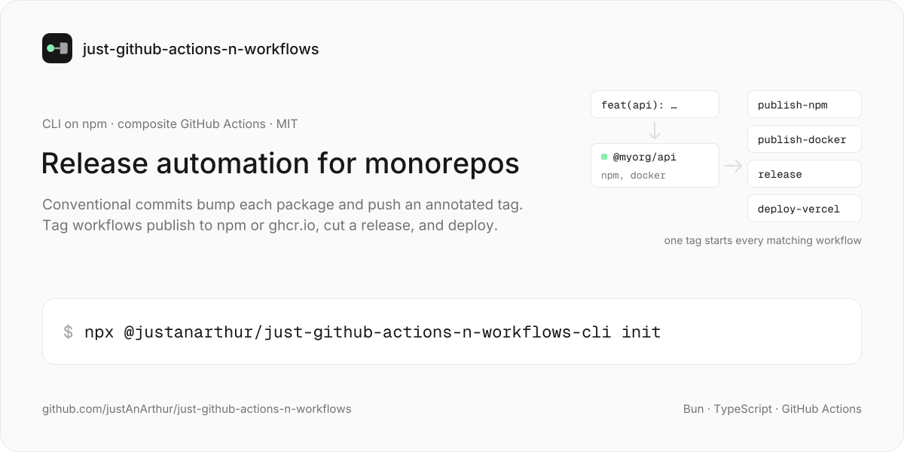
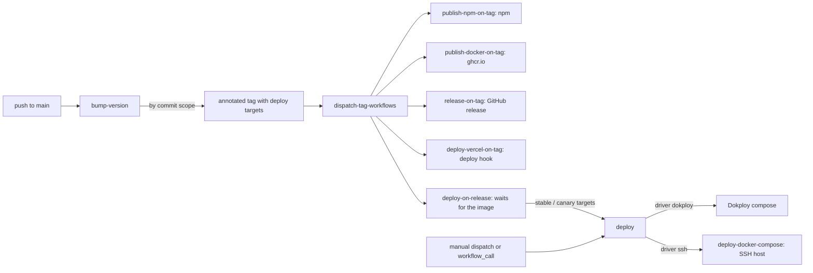

<a href="https://github.com/justAnArthur/just-github-actions-n-workflows"></a>

# just-github-actions-n-workflows

[](https://www.npmjs.com/package/@justanarthur/just-github-actions-n-workflows-cli) [](LICENSE)

> **v1.0.1 — stable release.** tags use the `@scope/name@1.0.1` per-package format. pin a specific major by referencing `@v1` after release; see *Repo-level tag* below. **CLI v1.0.2+** is installable from npm — the lib workspace dep is rewritten to a concrete version at publish time, so `npx` and `npm install -g` both work.

generic, versioned CI/CD workflow toolkit — version bumping, npm publishing, docker publishing, vercel deployment, docker compose and Dokploy deployment, PR previews.  
built as **composite GitHub Actions** powered by [Bun](https://bun.sh).

```bash
npx @justanarthur/just-github-actions-n-workflows-cli init   # pick workflows, write them to .github/workflows/
```

## for AI agents

if you're an LLM helping a user adopt this toolkit, read this section first. it lists what is actually here and the patterns that work — not the ones you'll invent by skimming the rest of the README.

### what's in this repo

- **10 workflow templates** in `workflows/` (the source of truth). each fires on tag push, pull request, manual dispatch, or as a reusable workflow:
  - `bump-version.yml` — auto-bumps package versions on push to main via conventional commits, then dispatches the tag workflows below for each new tag. releasing from other branches (`canary`, `versions/**`)? call it from a tiny caller workflow, see [release branches other than main](#release-branches-other-than-main)
  - `publish-npm-on-tag.yml` — runs `bun publish` for the npm registry
  - `publish-docker-on-tag.yml` — builds and pushes a docker image to ghcr.io
  - `release-on-tag.yml` — creates a github release with notes
  - `deploy-vercel-on-tag.yml` — POSTs a deploy hook to vercel, or fans one tag out to several vercel projects (`vercel.targets` in `.justactions.yml`)
  - `deploy-docker-compose.yml` — runs `docker compose` on a remote SSH host
  - `deploy.yml` — deploys a release to one `.justactions.yml` target, by its `driver`: Dokploy, or ssh through `deploy-docker-compose.yml`
  - `deploy-on-release.yml` — on a release tag, deploys to every target whose `channel` (`stable` / `canary`) matches the tag, once the image is on ghcr.io
  - `preview.yml` — builds a pull request and deploys it as its own Dokploy compose at `pr-<n>.<your domain>`
  - `preview-cleanup.yml` — removes that preview and its images when the pull request closes
- **23 composite actions** in `actions/` (each is `action.yml` + `src/index.ts`; see [available actions](#available-actions) for the full list)
- **a CLI** in `cli/` with `init` / `update` / `status` commands. it scaffolds workflows into a target repo, tracks them in a lockfile, and also writes `.github/AGENTS.md` so the downstream repo's own AI agents learn the conventions.

### three ways to adopt

| path | what it does | when to use |
|------|--------------|-------------|
| **file copy** | `curl` workflow files from `workflows/` into `.github/workflows/` of the target repo | simple, single-user, no lockfile overhead |
| **action reference** | `uses: justAnArthur/just-github-actions-n-workflows/actions/<name>@main` in your own workflow | mixing pieces (e.g. just `setup-ssh` + `scp-transfer`) |
| **CLI install** | `npx @justanarthur/just-github-actions-n-workflows-cli@1.0.2 init` | team-managed, versioned, updateable. **works since CLI v1.0.2** (pin-workspace-versions rewrites the lib dep at publish time, so `npm install` / `npx` resolve correctly). |

**don't invent a fourth path.** if the user asks for something the toolkit already does, use one of these three — do not fork a workflow file and patch in custom logic. the templates are designed to be copied whole and configured via the manifest's `properties` block and `.justactions.yml`, not edited in place.

### common scenarios (copy-paste recipes)

| scenario | what to copy into `.github/workflows/` | secrets required |
|----------|------------------------------------------|-------------------|
| bump + npm publish + github release | `bump-version.yml`, `publish-npm-on-tag.yml`, `release-on-tag.yml` | `NPM_TOKEN` |
| bump + docker image (ghcr.io) + release | `bump-version.yml`, `publish-docker-on-tag.yml`, `release-on-tag.yml` | (none — uses `GITHUB_TOKEN`) |
| bump + npm publish + docker image + release | `bump-version.yml`, `publish-npm-on-tag.yml`, `publish-docker-on-tag.yml`, `release-on-tag.yml` | `NPM_TOKEN` |
| bump + npm + GitHub Packages (`npm.pkg.github.com`) + release | `bump-version.yml`, `publish-npm-on-tag.yml`, `release-on-tag.yml`, **+ a copy of `publish-npm-on-tag.yml` renamed to `publish-gh-packages.yml` with a `.npmrc` step pointing at `https://npm.pkg.github.com` before `bun publish`** | `NPM_TOKEN` (public), `GH_TOKEN` (with `write:packages`) |
| bump + vercel deploy | `bump-version.yml`, `deploy-vercel-on-tag.yml` | `VERCEL_DEPLOY_HOOK_URL` |
| bump + one app deployed to N vercel projects (per client / per env), prereleases to staging, stable to production | `bump-version.yml`, `deploy-vercel-on-tag.yml` + `vercel.targets` in `.justactions.yml` (see [vercel fan-out](#vercel-fan-out)) | one hook secret per target, named by `hook_secret` |
| bump + docker image + auto-deploy to Dokploy | `bump-version.yml`, `publish-docker-on-tag.yml`, `deploy-on-release.yml`, `deploy.yml`, `deploy-docker-compose.yml` (loaded by `deploy.yml` even when unused) | `DOKPLOY_API_KEY` |
| PR previews on Dokploy | `preview.yml` + a small `pull_request` caller (see [PR previews](#pr-previews)), `preview-cleanup.yml` | `DOKPLOY_API_KEY` (+ `SSH_PRIVATE_KEY`, `SERVER_USERNAME` for seeding) |

### anti-patterns

- **don't confuse registries.** npm packages (npmjs.com or npm.pkg.github.com) go through `publish-npm-on-tag.yml`. container images (ghcr.io) go through `publish-docker-on-tag.yml`. they are different workflows. there is no "publish-everything" workflow.
- **don't fork a template and patch in custom registry logic.** if a user needs to publish to a non-default registry, copy the template, change the registry in the copy, and let both workflows run on the same tag push. the original stays untouched in this repo so updates keep flowing.
- **don't write a manual `.npmrc` swap inside a publish step.** the toolkit doesn't do that, and any change you make inside a fork won't reach other consumers. put the `.npmrc` in the package directory at install time, or add a `.npmrc` step before the `bun publish` step in a *copy* of the workflow, not a fork.
- **don't add a "publish on bump" glue workflow.** tags pushed with `GITHUB_TOKEN` never start `on: push: tags` workflows, so `bump-version.yml` itself dispatches every installed workflow whose `push.tags` filter matches a new tag (see [how release tags reach the tag workflows](#how-release-tags-reach-the-tag-workflows)). an extra `workflow_run` → `gh workflow run` workflow on top of that publishes twice.
- **don't drop the `workflow_dispatch` `tag` input from a copied tag workflow.** that input is how `bump-version.yml` starts it — a copy without it (or with another required input) is skipped with a warning.
- **don't build images on the Dokploy server.** Dokploy only deploys here: `publish-docker-on-tag.yml` / `preview.yml` build in CI and push to ghcr.io, `deploy.yml` / `preview.yml` hand Dokploy the new tag. don't point a Dokploy compose at the git repo with a `build:` section, and don't add a registry-watching webhook — Dokploy can't watch a registry.
- **don't reuse an image tag for a new preview build.** Dokploy doesn't pull a tag it already has, which is why `preview.yml` tags `pr-<n>-<sha8>`.
- **don't modify the workflows after they're installed in `.github/workflows/`.** the `init` / `update` commands will overwrite local edits on the next run. adding `# local-edit:` or `# toolkit-ref:` comments does not protect them. the only safe places to customize behavior are at the package level — see [where to override](#where-to-override) below.
- **don't tell the user to clone the toolkit to use the CLI.** since CLI v1.0.2, `npx @justanarthur/just-github-actions-n-workflows-cli@1.0.2 init` works from any directory and resolves the lib dep correctly. the local-clone path is only needed for development on the toolkit itself.

### where to override

the workflows are immutable after install — local edits are overwritten by `update`. customization happens at the package level, which the workflows read on each run:

| need | where to put it |
|------|-----------------|
| publish to a specific npm registry (e.g. `npm.pkg.github.com`, a private registry, a tag like `next`) | `publishConfig` in the package's `package.json` |
| per-package auth token (e.g. GH Packages) | `.npmrc` in the package's directory |
| pre-publish steps (build, generate assets, etc.) | the existing `Build` step in `publish-npm-on-tag.yml` already runs `bun run --silent build` — add a `build` script to `package.json`, no workflow edit needed |
| bump logic / tag format | `properties` in the package's `package.json` (`gitCommitScopeRelatedNames`, `deployTargets`, `dockerfilePath`, `vercelProjectId`) |
| which vercel projects a tag deploys to, per channel (`beta`, `stable`, …) | `vercel.targets` in `.justactions.yml` |
| deploy config (ssh target, compose profiles, Dokploy compose, release channel, previews) | `.justactions.yml` at the repo root |
| extra docker build args or BuildKit secrets for one package (values from repo vars / secrets), a build network, a service container a `RUN` step needs (e.g. a throwaway database) | `modules.overrides[].docker` in `.justactions.yml` — see [docker build settings](#docker-build-settings). read by `publish-docker-on-tag.yml` and `preview.yml` |
| approval before a deploy (required reviewers, wait timer) | a GitHub Environment named like the target — `deploy.yml` runs its deploy job in it |
| skip the bundled GitHub release that `publish-npm-on-tag.yml` creates | not currently supported without a fork — open an upstream issue. `release-on-tag.yml` is a separate workflow that *also* fires on tag push, so you can disable the bundled release by switching to a custom workflow (own the maintenance yourself) |

the `publish-npm-on-tag.yml` step that runs the actual publish is:

```yaml
- name: Publish to npm
  if: steps.gate.outputs.skip != 'true'
  working-directory: ${{ steps.pkg.outputs.dir }}
  run: bun publish -p --access public --tag ${{ needs.resolve-meta.outputs.npm_tag }}
  env:
    NPM_CONFIG_TOKEN: ${{ secrets.NPM_TOKEN }}
```

this invocation reads `publishConfig` from the package's `package.json` and `.npmrc` from the package's directory. **that is the supported override surface.** do not introduce a workflow that swaps `.npmrc` at runtime, hard-codes a second registry, or removes the bundled release step — every one of those becomes unmergeable the next time `update` runs.

### if the user wants their own repo's AI agents to know about this toolkit

the CLI's `init` (or `update`) automatically writes `.github/AGENTS.md` (with a symlink at repo root) so any agent landing in the downstream repo learns the conventions. this file is owned by the toolkit — `update` rewrites it on every upgrade. to customize agent-facing instructions for the user's own repo, write a separate `CONTRIBUTING.md`.

## use this in your repo

pick the path that matches how much you want to take:

### path A — copy workflow files (works today, no CLI)

the most reliable option right now. each workflow file in `workflows/` is self-contained: it has `push` / `workflow_dispatch` / `workflow_call` triggers and a header comment explaining how to use it.

1. **copy the files you want** into `.github/workflows/` of your repo:

   ```bash
   mkdir -p .github/workflows
   curl -fsSL https://raw.githubusercontent.com/justAnArthur/just-github-actions-n-workflows/v1.0.1/workflows/bump-version.yml       > .github/workflows/bump-version.yml
   curl -fsSL https://raw.githubusercontent.com/justAnArthur/just-github-actions-n-workflows/v1.0.1/workflows/publish-npm-on-tag.yml > .github/workflows/publish-npm-on-tag.yml
   # add any other workflows from https://github.com/justAnArthur/just-github-actions-n-workflows/tree/main/workflows
   ```

2. **add the required secrets** under your repo → Settings → Secrets → Actions. the workflows read these as `${{ secrets.<NAME> }}`. all workflows use the auto-provided `GITHUB_TOKEN` for github api calls — no PAT required unless you have a specific reason to set one.

   | workflow                          | secrets (in addition to auto `GITHUB_TOKEN`)               |
   |-----------------------------------|-------------------------------------------------------------|
   | `bump-version.yml`                | (none — needs `actions: write`, already granted in the file); optional `GH_TOKEN` |
   | `publish-npm-on-tag.yml`          | `NPM_TOKEN`                                                 |
   | `publish-docker-on-tag.yml`       | (optional `NPM_TOKEN` build-arg); optional `GH_TOKEN`       |
   | `deploy-vercel-on-tag.yml`        | `VERCEL_DEPLOY_HOOK_URL`, or one secret per `vercel.targets` entry |
   | `release-on-tag.yml`              | (none)                                                      |
   | `deploy-docker-compose.yml`       | `SSH_PRIVATE_KEY`, `SERVER_USERNAME`; optional `DOCKER_USERNAME`, `DOCKER_PASSWORD` (registry login skipped when empty) |
   | `deploy.yml`, `deploy-on-release.yml` | `DOKPLOY_API_KEY` (dokploy targets); the `deploy-docker-compose.yml` secrets (ssh targets); optional `GH_TOKEN` (`deploy-on-release.yml`) |
   | `preview.yml`                     | `DOKPLOY_API_KEY`; `SSH_PRIVATE_KEY`, `SERVER_USERNAME` with `previews.seed`; optional `NPM_TOKEN` build-arg; optional `GH_TOKEN` |
   | `preview-cleanup.yml`             | `DOKPLOY_API_KEY`; `SSH_PRIVATE_KEY`, `SERVER_USERNAME` with `previews.cleanup_command`; optional `GH_TOKEN` |

   `GH_TOKEN` is an optional PAT for private packages / cross-repo registry access. when set, it replaces `GITHUB_TOKEN` for the ghcr.io login, the `github_token` BuildKit secret of docker builds (`RUN --mount=type=secret,id=github_token cat /run/secrets/github_token`), and the GitHub packages API calls (prerelease cleanup, image checks, preview image deletion).

3. **configure each package's manifest** with a `properties` block so the bump-version workflow knows which package to bump on which commit scope. see [manifest configuration](#manifest-configuration) for the schema.

4. **commit and push**:

   ```bash
   git add .github/ && git commit -m "ci: add release workflows" && git push
   ```

5. **release your first version**:

   ```bash
   # push a tag manually the first time. after this, every push to main
   # will auto-bump the matching package based on conventional commits.
   git tag @scope/my-package@1.0.0    # adjust scope + name + version
   git push origin @scope/my-package@1.0.0
   ```

### path B — reference actions directly (modular)

if you only want a couple of pieces (e.g. just `setup-ssh` + `scp-transfer`), reference individual actions in your own workflows:

```yaml
# .github/workflows/deploy.yml
name: deploy

on:
  push:
    branches: [ main ]

jobs:
  deploy:
    runs-on: ubuntu-latest
    steps:
      - uses: justAnArthur/just-github-actions-n-workflows/actions/setup-ssh@main
        with:
          private_key: ${{ secrets.SSH_PRIVATE_KEY }}
          host: my-server.com

      - uses: justAnArthur/just-github-actions-n-workflows/actions/ssh-exec@main
        with:
          host: my-server.com
          username: ${{ secrets.SERVER_USERNAME }}
          script: |
            cd ~/my-app
            docker compose pull
            docker compose up -d
```

pin to `@v1` for major-version stability — the `v1.0.1` repo-level tag is live.

### path C — CLI install (best UX, works since CLI v1.0.2)

the CLI scaffolds workflows into your repo, tracks installed versions in a lock file, and lets you update with one command. the right path for most teams:

```bash
npx @justanarthur/just-github-actions-n-workflows-cli@1.0.2 init
```

use `--cwd <path>` to target a worktree or different repo without `cd`-ing. the published CLI's lib dep is rewritten at publish time by `pin-workspace-versions`, so `npx` resolves lib correctly from the registry — no local clone needed for end users.

only needed for toolkit development:

```bash
git clone https://github.com/justAnArthur/just-github-actions-n-workflows.git
cd just-github-actions-n-workflows
bun install
bun run cli/ <command>             # see "cli" section below
```

## end-to-end example: ship a 3-package monorepo to npm + docker

concrete walkthrough of what a release cycle looks like with this toolkit installed.

**repo shape** (the `packages/api`, `packages/web`, `packages/shared` layout):

```
my-monorepo/
├── package.json                     # workspace root, name: "my-monorepo"
├── packages/
│   ├── shared/
│   │   ├── package.json             # name: "@myorg/shared"
│   │   └── src/index.ts
│   ├── api/
│   │   ├── package.json             # name: "@myorg/api", properties.dockerfilePath
│   │   ├── Dockerfile
│   │   └── src/server.ts
│   └── web/
│       ├── package.json             # name: "@myorg/web"
│       └── src/app.tsx
└── .github/workflows/
    ├── bump-version.yml             # copied from this repo
    └── publish-npm-on-tag.yml       # copied from this repo
```

**step 1 — declare what each package bumps on**. open each `package.json`, add the `properties` block:

```jsonc
// packages/shared/package.json
{
  "name": "@myorg/shared",
  "version": "0.1.0",
  "properties": {
    "gitCommitScopeRelatedNames": "shared,lib"
  }
}
```

```jsonc
// packages/api/package.json
{
  "name": "@myorg/api",
  "version": "0.1.0",
  "properties": {
    "gitCommitScopeRelatedNames": "api,backend",
    "dockerfilePath": "./Dockerfile"     // enables "docker" deploy target
  }
}
```

```jsonc
// packages/web/package.json
{
  "name": "@myorg/web",
  "version": "0.1.0",
  "properties": {
    "gitCommitScopeRelatedNames": "web,frontend"
  }
}
```

**step 2 — set secrets** in your GitHub repo: `GH_TOKEN`, `NPM_TOKEN`.

**step 3 — write code with conventional commits**. the commit scope determines which package gets bumped:

```bash
git commit -m "feat(api): add /healthz endpoint"      # bumps @myorg/api only
git commit -m "fix(shared): correct date formatting"  # bumps @myorg/shared only
git commit -m "feat(frontend): redesign dashboard"    # bumps @myorg/web only
git push                                              # bump-version.yml auto-bumps on push to main
```

**step 4 — release**. the bump-version workflow pushes annotated tags like `@myorg/api@0.2.0` with a JSON annotation listing the deploy targets, then dispatches `publish-npm-on-tag.yml` (and every other installed tag workflow) for each new tag. the publish-npm workflow then:
- for `npm`-tagged packages → publishes to npm at the new version
- for non-npm-tagged packages (private, lib, etc.) → skips
- creates a GitHub release with conventional-commit-derived notes

if you also want docker images built and pushed to ghcr.io, copy `publish-docker-on-tag.yml` as well.

**step 5 — keep things updated**. when a new toolkit release lands, either re-run `init` (when CLI install is fixed) or re-curl the workflow files:

```bash
curl -fsSL https://raw.githubusercontent.com/justAnArthur/just-github-actions-n-workflows/v1.2.0/workflows/bump-version.yml > .github/workflows/bump-version.yml
git diff .github/workflows/bump-version.yml           # review what changed
git add . && git commit -m "ci: bump toolkit to v1.2.0" && git push
```

## overview

this is a repo of **generic, installable/updatable workflows** for project release automation.
each workflow works with project **modules** — independent packages within a monorepo (or single-repo), each with its own **manifest** (`package.json`, `pom.xml`, `Cargo.toml`, etc.) that is parsed into a unified `Module` object used across all workflows.

### core concepts

- **module** — a project component with its own manifest, version, and optional Dockerfile
- **manifest** — a file (`package.json`, `pom.xml`, `Cargo.toml`, …) that declares the module's name, version, and metadata
- **adapter** — a pluggable parser for each manifest type (npm, maven, cargo, … more to come)
- **deploy targets** — deployment types inferred from the manifest (`npm`, `docker`, `vercel`) and embedded in git tag annotations
- **settings file** (`.justactions.yml`) — per-project config for deploy targets, module overrides, etc.

## cli

the CLI is `cli/` in this repo. it ships on npm at `@justanarthur/just-github-actions-n-workflows-cli` (v1.0.2+, installable directly).

### install (from npm — recommended)

```bash
npm install -g @justanarthur/just-github-actions-n-workflows-cli
# or
npx @justanarthur/just-github-actions-n-workflows-cli@1.0.2 <command>
```

the published CLI's `lib` dep is rewritten to a concrete version by the toolkit's `pin-workspace-versions` action at publish time, so `npm install` / `npx` resolve correctly.

### install (from source, only for toolkit development)

```bash
git clone https://github.com/justAnArthur/just-github-actions-n-workflows.git
cd just-github-actions-n-workflows
bun install
bun run cli/ <command>
```

### commands

#### `init` — scaffold workflows

```bash
# interactive — pick version, select workflows
just-github-actions-n-workflows init

# install specific workflows by name
just-github-actions-n-workflows init bump-version publish-npm-on-tag

# install all workflows non-interactively
just-github-actions-n-workflows init --yes

# pin to a specific version
just-github-actions-n-workflows init --ref v1.0.1

# overwrite existing workflow files
just-github-actions-n-workflows init --force

# skip creating .justactions.yml
just-github-actions-n-workflows init --no-settings

# skip scaffolding .github/AGENTS.md and the root symlink
just-github-actions-n-workflows init --no-agents

# target a different repo directory (no need to `cd` first)
just-github-actions-n-workflows init --cwd /path/to/target-repo --yes

# list available workflows without installing
just-github-actions-n-workflows init --list
```

`init` and `update` also write `.github/AGENTS.md` (with a symlink at the repo root as `AGENTS.md`) so an AI coding agent landing in this repo gets a guide to the release machinery: conventional-commit scope mapping, the `@scope/name@version` tag annotation JSON contract, why a publish might skip, and the secrets it shouldn't touch. this file is owned by the toolkit — `update` rewrites it on every upgrade. to customize agent-facing instructions for your specific repo, write a separate `CONTRIBUTING.md` instead.

| flag             | short | description                                      |
|------------------|-------|--------------------------------------------------|
| `--list`         | `-l`  | show available workflows without installing      |
| `--force`        | `-f`  | overwrite existing workflow files                |
| `--yes`          | `-y`  | skip interactive prompts, install all workflows  |
| `--ref <ref>`    |       | git ref to fetch from (tag, branch, sha)         |
| `--cwd <path>`   |       | target repo directory (defaults to current dir)  |
| `--no-settings`  |       | skip creating the `.justactions.yml` file        |
| `--no-agents`    |       | skip scaffolding `.github/AGENTS.md` and the root symlink |

the `init` command:
1. fetches available versions (sorted by semver, latest first)
2. lets you pick which workflows to install
3. writes the workflow files to `.github/workflows/`
4. scaffolds a `.justactions.yml` settings template
5. writes a `.toolkit-lock.json` lock file tracking installed versions

```
$ just-github-actions-n-workflows init

  just-github-actions-n-workflows
  release automation toolkit

  step 1 — select version

? Pick a version
❯ 1.0.1 (latest stable)
  0.0.0-beta.11
  0.0.0-beta.8

  step 2 — select workflows

? Select workflows to install
  bump-version               auto-bump module versions on push
  publish-npm-on-tag         publish to npm + github release
  publish-docker-on-tag      build + publish docker image
  deploy-vercel-on-tag       deploy to vercel on tag push
  release-on-tag             create github release with notes
  deploy-docker-compose      deploy docker compose to remote server

  step 3 — install

  create  .github/workflows/bump-version.yml
  create  .github/workflows/publish-npm-on-tag.yml
  create  .justactions.yml

  lock file written → .github/workflows/.toolkit-lock.json

done — 2 created, 0 skipped

  required secrets:

  • GH_TOKEN           github token with contents:write
  • NPM_TOKEN          npm registry publish token

  set these in your repo → Settings → Secrets → Actions

  next steps:

  1. set the secrets listed above
  2. adjust push.branches / push.tags triggers for your repo
  3. configure .justactions.yml with your deploy targets (if using deploy workflow)
  4. commit and push:
     git add .github/ .justactions.yml && git commit -m "ci: add workflows" && git push
```

#### `update` — update installed workflows

```bash
# update all workflows to the latest version
just-github-actions-n-workflows update

# update to a specific version
just-github-actions-n-workflows update --ref v2.0.0

# skip confirmation prompt
just-github-actions-n-workflows update --yes

# target a different repo directory (no need to `cd` first)
just-github-actions-n-workflows update --cwd /path/to/target-repo --yes
```

reads `.toolkit-lock.json` to find installed workflows, compares versions, and re-fetches outdated ones. also re-writes `.github/AGENTS.md` so doc improvements ship to existing users. **must be run from the repo root** (same constraint as `status`).

#### `status` — check installed workflow versions

```bash
# show status of installed workflows
just-github-actions-n-workflows status

# compare against a specific ref
just-github-actions-n-workflows status --ref v2.0.0

# target a different repo directory (no need to `cd` first)
just-github-actions-n-workflows status --cwd /path/to/target-repo
```

shows which workflows are up to date and which can be updated. resolves `.github/workflows/.toolkit-lock.json` and `.github/AGENTS.md` relative to `--cwd` (or `process.cwd()` if not set), so you can run it from any directory as long as you point `--cwd` at the repo root.

## settings file

create a `.justactions.yml` in your repo root to configure deploy targets and module overrides. the `init` command scaffolds this file automatically. only needed if you use one of the deploy workflows (`deploy-docker-compose.yml`, `deploy.yml`, `deploy-on-release.yml`, `preview.yml`, `preview-cleanup.yml`).

```yaml
# .justactions.yml
deploy:
  ssh_target_path: ~/my-app
  targets:
    production:
      host: app.example.com
      compose_profiles: "@scope/backend,@scope/frontend"
      profiles: "prod"
      timezone: Europe/Bratislava
    staging:
      host: staging.example.com
      compose_profiles: "@scope/backend"
      profiles: "staging"
      timezone: UTC

vercel:
  targets:
    client-a:
      hook_secret: VERCEL_HOOK_CLIENT_A
      channels: [beta, stable]
      packages: ["@scope/www"]
    client-a-staging:
      hook_secret: VERCEL_HOOK_CLIENT_A_STAGING
      channels: [beta]
      packages: ["@scope/www"]

modules:
  overrides:
    - name: "@scope/backend"
      docker_compose_service: backend
```

### settings reference

| path                                  | type     | description                                             |
|---------------------------------------|----------|---------------------------------------------------------|
| `deploy.ssh_target_path`              | string   | remote path for deployment files; a leading `~/` is the remote home |
| `deploy.targets.<name>.host`          | string   | ssh hostname for the environment                        |
| `deploy.targets.<name>.compose_profiles` | string | comma-separated module names to deploy                 |
| `deploy.targets.<name>.profiles`      | string   | docker compose profile names                            |
| `deploy.targets.<name>.timezone`      | string   | timezone for the environment (default: `UTC`)           |
| `deploy.targets.<name>.driver`        | string   | `ssh` (default) or `dokploy`                            |
| `deploy.targets.<name>.channel`       | string   | `manual` (default), `stable` or `canary` — what `deploy-on-release.yml` deploys here |
| `deploy.targets.<name>.dokploy.compose_id` | string | Dokploy compose to redeploy (required for `dokploy`) |
| `deploy.dokploy.url`                  | string   | Dokploy base url (required by `dokploy` targets and previews); the key is the `DOKPLOY_API_KEY` secret |
| `deploy.previews.dokploy.environment_id` | string | Dokploy environment that holds the previews         |
| `deploy.previews.dokploy.server_id`   | string   | Dokploy server for new previews (optional)              |
| `deploy.previews.host`                | string   | preview hostname, `{pr}` is the PR number               |
| `deploy.previews.compose_file`        | string   | compose file of a preview, read from the PR's merge commit |
| `deploy.previews.env.<KEY>`           | string   | extra env lines; `{pr}`, `{host}`, `{image_tag}` are filled in |
| `deploy.previews.images[]`            | string   | manifest names of the modules built for a preview       |
| `deploy.previews.seed.ssh_host`       | string   | host the seed and cleanup commands run on               |
| `deploy.previews.seed.command`        | string   | run on every deploy while it is pending, so it must be idempotent (skip when already seeded); also `{app_name}` |
| `deploy.previews.seed.upload.<repo path>` | string | remote path the file is copied to before seeding     |
| `deploy.previews.cleanup_command`     | string   | run by `preview-cleanup.yml` on `seed.ssh_host`         |
| `vercel.targets.<name>.hook_secret`   | string   | **required.** name of the repo secret holding this target's deploy hook URL |
| `vercel.targets.<name>.channels`      | list     | release channels that deploy here: `stable` and/or prerelease ids (`beta`, `rc`, …). default: `[stable]` |
| `vercel.targets.<name>.packages`      | list     | package names that deploy here. default: any package    |
| `modules.overrides[].name`            | string   | module name to override                                 |
| `modules.overrides[].docker_compose_service` | string | docker compose service name for the module         |
| `modules.overrides[].docker.build_args.<KEY>` | string | extra build arg; may reference `${{ vars.NAME }}` / `${{ secrets.NAME }}` |
| `modules.overrides[].docker.secrets.<id>` | string | extra BuildKit secret (`RUN --mount=type=secret,id=<id>`); same references |
| `modules.overrides[].docker.network`  | string   | build network, e.g. `host` so `RUN` steps reach `docker.service` on localhost |
| `modules.overrides[].docker.service.image` | string | service container started next to the build job      |
| `modules.overrides[].docker.service.port` | number | published on the same port of the runner             |
| `modules.overrides[].docker.service.env.<KEY>` | string | service env (no whitespace in values)            |
| `modules.overrides[].docker.service.options` | string | extra `docker create` options, e.g. a health check  |
| `modules.overrides[].docker.preview.build_args.<KEY>` | string \| null | `preview.yml` only: overrides the build arg; `~` (null) drops it |
| `modules.overrides[].docker.preview.network` | string | `preview.yml` only: overrides `docker.network`         |
| `modules.overrides[].docker.preview.service` | `false` | `preview.yml` only: starts no service container       |

one setting is a repository variable instead, because a job's runner is picked before any step can read `.justactions.yml`:

| variable              | description                                             |
|-----------------------|---------------------------------------------------------|
| `JUSTACTIONS_RUNS_ON` | JSON `runs-on` of every job of every workflow, e.g. `["self-hosted","ryde"]`; default `"ubuntu-latest"`. see [runners, caches and timeouts](#runners-caches-and-timeouts) |

### vercel fan-out

one package, many vercel projects — e.g. the same app deployed once per client. with `vercel.targets` set, `deploy-vercel-on-tag.yml` POSTs every target whose `packages` include the tag's package **and** whose `channels` include the tag's channel:

- the channel is the tag's prerelease id (`@scope/www@1.4.0-beta.2` → `beta`) or `stable` for a plain version (`@scope/www@1.4.0`).
- a target only gets production deploys once you add `stable` to its `channels` — that is the per-target cut-over switch.
- the job summary lists every target as `fired`, `skipped` (with the reason) or `failed`. a missing secret or a non-2xx response fails the job after all other hooks were tried.
- without `vercel.targets` the workflow behaves as before: it POSTs `VERCEL_DEPLOY_HOOK_URL` for every tag.

```yaml
# .justactions.yml — beta tags hit every client's staging project, stable tags only cut-over clients
vercel:
  targets:
    client-a:
      hook_secret: VERCEL_HOOK_CLIENT_A          # cut over: gets prereleases and production
      channels: [beta, stable]
      packages: ["@scope/www"]
    client-b:
      hook_secret: VERCEL_HOOK_CLIENT_B          # not cut over yet: prereleases only
      channels: [beta]
      packages: ["@scope/www"]
```

**how hook secrets reach the action.** github expressions can't read a secret by a computed name, so the workflow passes the job's whole secrets context (`toJSON(secrets)`) to `trigger-deploy-hook`, which picks the names listed in `hook_secret` and re-masks each URL. the trade-off: every repo/org secret visible to that job is handed to the toolkit's code, not just the hook URLs. github still masks them in logs, and the job only has `contents: read`, but if you don't want the toolkit to see other secrets, pin the action/workflow ref to a release tag or commit SHA you've reviewed, or keep the vercel deploy in a repo whose secrets are only the hook URLs. when calling the workflow via `workflow_call`, use `secrets: inherit` — named secrets can't be forwarded because their names aren't declared inputs.

## docker build settings

`publish-docker-on-tag.yml` and `preview.yml` build every image with the same build args and secrets. a package that needs more sets them in `.justactions.yml`, so the installed workflows stay untouched:

```yaml
# .justactions.yml
modules:
  overrides:
    - name: "@scope/frontend"
      docker:
        build_args:
          NEXT_PUBLIC_SENTRY_DSN: ${{ vars.NEXT_PUBLIC_SENTRY_DSN }}
          SENTRY_ORG: ${{ vars.SENTRY_ORG }}
        secrets:                                   # RUN --mount=type=secret,id=sentry_auth_token
          sentry_auth_token: ${{ secrets.SENTRY_AUTH_TOKEN }}
    - name: "@scope/backend"
      docker:
        network: host                              # RUN steps reach the service on localhost
        build_args:
          TRAINING_DB_URL: jdbc:postgresql://localhost:5432/app
        service:                                   # started next to this package's build only
          image: postgis/postgis:16-3.4
          port: 5432
          env:
            POSTGRES_HOST_AUTH_METHOD: trust
            POSTGRES_DB: app
          options: --health-cmd pg_isready --health-interval 5s --health-timeout 5s --health-retries 10
```

- the settings come from the tagged commit (`publish-docker-on-tag.yml`) or from the ref the workflow runs on (`preview.yml`, like the rest of `deploy.previews`).
- values may reference `${{ vars.NAME }}` and `${{ secrets.NAME }}`, nothing else; an unset one is passed empty with a warning, as in a workflow. other values are passed as written.
- they are added after the default build args (`USERNAME_GITHUB`, `TOKEN_GITHUB`, `TAG_NAME`, `SANITIZED_IMAGE_TAG`, `NPM_TOKEN`) and the `github_token` secret, which stay.
- the service is a job service container: github starts it, waits for its health check, and publishes `port` on the runner. a package without `service` starts none.
- packages without `docker` settings build exactly as before.

**preview builds.** `docker.preview` changes a package's build for `preview.yml` only, e.g. to skip a slow step a release needs but a preview doesn't:

```yaml
    - name: "@scope/backend"
      docker:
        network: host
        build_args:
          TRAINING_DB_URL: jdbc:postgresql://localhost:5432/app
        service: { image: postgis/postgis:16-3.4, port: 5432 }
        preview:
          build_args:
            TRAINING_DB_URL: ~                     # ~ drops the arg, a string replaces it
          service: false                           # no database next to preview builds
```

**secrets.** like the vercel fan-out, the build job passes `toJSON(secrets)` to the toolkit's `render-docker-build` action, which picks the referenced ones. called through `workflow_call`, use `secrets: inherit`.

## runners, caches and timeouts

**docker layer cache.** `publish-docker-on-tag.yml` and `preview.yml` keep their BuildKit cache in the registry, next to the image, instead of the GitHub Actions cache (10 GB per repository, evicted when full):

| workflow                    | reads                                   | writes                |
|-----------------------------|-----------------------------------------|-----------------------|
| `publish-docker-on-tag.yml` | `<image>:buildcache`                    | `<image>:buildcache`  |
| `preview.yml`               | `<image>:buildcache-preview`, `<image>:buildcache` | `<image>:buildcache-preview` |

`<image>` is `ghcr.io/<owner>/<repo>/<package image name>`. the cache is exported with `mode=max` (every stage) and `ignore-error=true`, so a failed export never fails a build. `preview-cleanup.yml` only deletes versions whose tags all start with `pr-<n>-`, and the prerelease cleanup of `bump-version.yml` only semver prerelease tags, so both keep the cache tags. nothing to configure.

**runners.** every job runs on `ubuntu-latest` unless the repository (or organization) variable `JUSTACTIONS_RUNS_ON` is set to a JSON `runs-on` value:

```bash
gh variable set JUSTACTIONS_RUNS_ON --body '["self-hosted","ryde"]'
```

a self-hosted runner needs `git` and `git-lfs`, `curl`, `unzip` (for `oven-sh/setup-bun`, which downloads Bun), `openssh-client` (ssh deploys and preview seeding), the `gh` CLI (`preview.yml` comments the url) and a Docker daemon with buildx — e.g. the `myoung34/github-runner` image with the host's Docker socket. no Maven, Java or Node is needed: the toolkit reads `pom.xml` itself, and builds happen inside the Dockerfiles. on a runner that keeps its home between jobs (not `EPHEMERAL`), the ssh key of `setup-ssh` and the `docker login` of the build jobs stay there. the `docker.service` of a build publishes its port on the Docker host, so builds of one package queue instead of running at once: `publish-docker-on-tag.yml` per package, `preview.yml` per package with a service (across pull requests). GitHub keeps only one waiting run per queue — a third run of the same package replaces the waiting one, which is then cancelled; dispatch it again with its tag.

**timeouts.** every job has a `timeout-minutes`: 30 for image builds and deploys, 45 for the preview deploy (it waits for Dokploy and the preview url), 60 for `deploy-on-release.yml`'s image wait, 10–20 for the rest.

## deploy with Dokploy

`deploy.yml` deploys one target from `.justactions.yml`. the target's `driver` picks how:

- **`ssh`** (default) — today's path, it calls `deploy-docker-compose.yml` unchanged. install that file next to `deploy.yml` even if every target is Dokploy: github loads every reusable workflow a file references before it runs.
- **`dokploy`** — resolves the image tags with `resolve-image-tags` and merges the `DOCKER_<NAME>_IMAGE_TAG` lines into the env of an existing Dokploy compose, then redeploys it and waits. env lines it doesn't set (secrets you keep in Dokploy) stay.

```yaml
# .justactions.yml
deploy:
  dokploy:
    url: https://dokploy.example.com       # DOKPLOY_API_KEY secret holds the key
  targets:
    demo:
      driver: dokploy
      channel: canary
      dokploy:
        compose_id: abc123
    production:
      driver: dokploy
      channel: stable
      dokploy:
        compose_id: def456
    legacy-prod:
      host: app.example.com                # ssh, as before
```

the compose in Dokploy references the images by tag, e.g. `image: ghcr.io/owner/repo/scope-backend:${DOCKER_SCOPE_BACKEND_IMAGE_TAG}`.

**why images are built in CI and Dokploy only deploys:** Dokploy can't watch a registry for new tags, and building on the target server is slow and takes cpu and memory from the apps running there. so `publish-docker-on-tag.yml` builds and pushes to ghcr.io as before, and Dokploy gets the tag to pull.

**channels.** a target's `channel` says which releases `deploy-on-release.yml` deploys to it:

| channel | gets |
|---------|------|
| `manual` (default) | nothing automatic — run `deploy.yml` from the Actions tab |
| `stable` | every release without a prerelease (`1.2.3`) |
| `canary` | every release with a `canary` / `beta` / `alpha` / `rc` prerelease |

`deploy-on-release.yml` starts like the other tag workflows (tag push, or dispatched by `bump-version.yml`), so it runs alongside `publish-docker-on-tag.yml`. it polls ghcr.io until the images exist, then calls `deploy.yml` for each matching target. each target gets every docker module at its newest version on the channel, with the released one pinned — so a bump that releases several modules at once ends with all of them deployed, whatever order the runs finish in. tags without the `docker` deploy target deploy nothing.

**approvals.** `deploy.yml` runs its deploy job in the GitHub Environment named like the target. add required reviewers to `production` under Settings → Environments and every deploy there waits for a click, automatic ones included. environment secrets work too, e.g. a different `DOKPLOY_API_KEY` per target (dokploy driver only — the ssh path reads repository secrets).

## PR previews

`preview.yml` builds a pull request and runs it as its own Dokploy compose named `pr-<n>`, at `deploy.previews.host`:

1. **prepare** — the PR must be open and mergeable. the preview is built from its merge commit; images are tagged `pr-<n>-<sha8>`, new on every build, because Dokploy doesn't pull a tag it already has.
2. **build** — one job per `previews.images` entry; dockerfile and build context come from the module's manifest like in `publish-docker-on-tag.yml`. pushed to `ghcr.io/<owner>/<repo>/<image>:pr-<n>-<sha8>`. `modules.overrides[].docker.preview` changes the build for previews only (see [docker build settings](#docker-build-settings)); the layer cache is described in [runners, caches and timeouts](#runners-caches-and-timeouts).
3. **deploy** — creates or updates the compose with the PR's `compose_file` and the env (`DOCKER_<NAME>_IMAGE_TAG` of every preview image plus `previews.env`), starts the deploy, and uploads `seed.upload` and runs `seed.command` over ssh while Dokploy deploys (on every deploy — make the command a no-op once the preview is seeded, so a re-run after a failed first deploy still seeds). then waits for the deploy and for `https://<host>` to answer, and comments the url on the PR.

```yaml
# .justactions.yml
deploy:
  dokploy:
    url: https://dokploy.example.com
  previews:
    dokploy:
      environment_id: <dokploy environment for previews>
      server_id: <dokploy server>          # optional
    host: "pr-{pr}.pr.example.com"
    compose_file: .github/preview/docker-compose.yml
    env:                                   # {pr}, {host}, {image_tag} are filled in
      PREVIEW_HOST: "{host}"
      PREVIEW_DIR: /home/app/previews/pr-{pr}
    images:
      - "@scope/backend"
      - "@scope/frontend"
    seed:                                  # optional
      ssh_host: test.example.com
      command: "bash ~/previews/pr-{pr}/seed.sh {app_name}-postgres-1"
      upload:
        .github/preview/seed.sh: ~/previews/pr-{pr}/seed.sh
    cleanup_command: "rm -rf ~/previews/pr-{pr}"   # optional, run by preview-cleanup.yml
```

route the host in the preview compose file (e.g. Traefik labels using `${PREVIEW_HOST}`) and point a wildcard DNS record at the Dokploy server. containers are named `<app_name>-<service>-1`, `{app_name}` in `seed.command` is that prefix.

`preview.yml` has no `pull_request` trigger of its own: it builds PR code with your secrets, so you decide when it runs. a small caller in your repo (not overwritten by `update`):

```yaml
# .github/workflows/pr-preview.yml
on:
  pull_request:
    types: [ opened, synchronize, reopened ]
jobs:
  preview:
    if: github.event.pull_request.head.repo.full_name == github.repository   # no forks
    uses: ./.github/workflows/preview.yml
    with:
      pr: ${{ github.event.pull_request.number }}
    secrets: inherit
```

`preview-cleanup.yml` runs when the PR closes: it deletes the compose and its volumes, runs `cleanup_command`, and deletes the `pr-<n>-*` images from ghcr.io (only a warning if the token can't delete packages).

## manifest configuration

modules are discovered by scanning the repo for manifest files (`package.json`, `pom.xml`, `Cargo.toml`). each manifest declares metadata in a `properties` section (`[*.metadata.justactions]` for Cargo.toml) that controls versioning and deployment.

### package.json

```jsonc
{
  "name": "@scope/my-package",
  "version": "1.0.0",
  "private": false,
  "properties": {
    // commit scopes that map to this package (comma-separated)
    // e.g. "feat(backend): ..." will bump this package's version
    "gitCommitScopeRelatedNames": "backend,api",

    // path to Dockerfile (relative to package.json directory)
    // enables "docker" deploy target
    "dockerfilePath": "./Dockerfile",

    // vercel project ID — enables "vercel" deploy target
    "vercelProjectId": "prj_xxxxxxxxxxxxx",

    // build priority (lower = build first, for monorepo ordering)
    "priority": 1,

    // explicit deploy targets override (comma-separated)
    // overrides auto-detection if set
    "deployTargets": "npm,docker,vercel"
  }
}
```

### pom.xml

```xml
<project>
  <name>my-service</name>
  <version>1.0.0</version>
  <properties>
    <!-- commit scopes that map to this module -->
    <gitCommitScopeRelatedNames>backend,api</gitCommitScopeRelatedNames>

    <!-- path to Dockerfile — enables "docker" deploy target -->
    <DockerfilePath>./Dockerfile</DockerfilePath>

    <!-- vercel project ID — enables "vercel" deploy target -->
    <vercelProjectId>prj_xxxxxxxxxxxxx</vercelProjectId>

    <!-- build priority -->
    <priority>1</priority>

    <!-- explicit deploy targets override -->
    <deployTargets>docker</deployTargets>
  </properties>
</project>
```

### Cargo.toml

workspace root — one version for every member crate:

```toml
[workspace.package]
version = "0.1.0"

[workspace.metadata.justactions]
name = "jbm"
gitCommitScopeRelatedNames = ["game", "client"]
```

standalone crate:

```toml
[package]
name = "my-crate"
version = "1.0.0"

[package.metadata.justactions]
name = "client"
DockerfilePath = "./Dockerfile"
```

module rules:

1. a `[package]` table with a literal `version` is a **crate** module
2. otherwise a `[workspace.package]` table with a literal `version` is a **workspace** module — one version for the whole workspace; the name comes from `[workspace.metadata.justactions]` `name` or `package.name`
3. anything else, such as a member crate with `version.workspace = true`, is skipped

a bump also rewrites the matching `Cargo.lock` entries so `--locked` builds keep passing.

### deploy targets

deploy targets are **inferred automatically** from manifest properties and embedded into git tag annotations when versions are bumped. downstream workflows read the annotation and skip jobs that don't apply.

| target   | auto-detected when                                | workflow                      |
|----------|---------------------------------------------------|-------------------------------|
| `npm`    | `private` is not `true` (package.json only)       | `publish-npm-on-tag.yml`      |
| `docker` | `dockerfilePath` is set                           | `publish-docker-on-tag.yml`   |
| `vercel` | `vercelProjectId` is set                          | `deploy-vercel-on-tag.yml`    |

to **override** auto-detection, set `properties.deployTargets` explicitly:

```jsonc
// only publish to npm, skip docker even though dockerfilePath is set
{ "properties": { "deployTargets": "npm" } }
```

```jsonc
// deploy to both docker and vercel
{ "properties": { "deployTargets": "docker,vercel" } }
```

### how deploy targets flow

1. **manifest parse** → adapter reads `package.json` / `pom.xml` / `Cargo.toml` and infers `deployTargets`
2. **version bump** → `bump-version` action creates an annotated git tag with `{"deployTargets":["npm","docker"]}` in the tag message
3. **dispatch** → `bump-version.yml` starts the publish/deploy workflows for each new tag (see below), `resolve-tag-meta` reads the tag annotation
4. **skip check** → each workflow checks its target (e.g. `publish_npm == 'true'`) and skips early if not present

for legacy tags without annotations, workflows fall back to runtime detection (e.g. `check-publishable` for npm, `get-dockerfile-path` for docker).

### how release tags reach the tag workflows

`bump-version.yml` pushes its tags with the auto-provided `GITHUB_TOKEN`, and GitHub never starts workflow runs from events created by that token (except `workflow_dispatch` / `repository_dispatch`). a plain tag push from bump-version therefore starts nothing.

so the last step of `bump-version.yml` runs the `dispatch-tag-workflows` action with the tags the bump just pushed. it scans `.github/workflows/`, picks every workflow whose `on.push.tags` / `tags-ignore` filter matches the tag, and starts it via `workflow_dispatch` **on the tag ref** with the tag as its `tag` input — so `github.ref_name` and `inputs.tag` are the tag, same as a real tag push. consequences:

- **no PAT needed.** the job has `permissions: actions: write`. if you call `bump-version.yml` as a reusable workflow, the caller must grant `actions: write` too.
- **copies are covered.** a `publish-gh-packages.yml` copy of `publish-npm-on-tag.yml` is dispatched like the original, as long as it keeps the `workflow_dispatch` `tag` input. narrowing its `push.tags` (e.g. `@myorg/api@*`) narrows what gets dispatched.
- **only workflows that filter on tags count.** an unfiltered `on: push` CI workflow is not started for release tags.
- **tags you push by hand** (e.g. the first release) still trigger the workflows the normal way — dispatch only covers tags bump-version created, so nothing runs twice.
- **a failed dispatch fails the bump job** with the tag and workflow named; re-run the tag workflow from the Actions tab with that tag as input.

### release branches other than main

`bump-version.yml` triggers on pushes to `main` only. a repo that releases from other branches keeps the installed file untouched (`update` would overwrite edits) and calls it from a tiny workflow of its own:

```yaml
# .github/workflows/bump-version-on-push.yml
name: bump-version-on-push
on: { push: { branches: [ canary, 'versions/**' ] } }
permissions: { contents: write, packages: write, actions: write }
jobs:
  bump: { uses: ./.github/workflows/bump-version.yml, secrets: inherit }
```

called from a push it behaves like a direct push run: `github.event` is the caller's push, so the bump comes from the pushed commits and a head commit with `[skip bump]` skips it; the checkout is the pushed branch, so the bump commit goes back to that branch; the new tags are dispatched as usual. the caller must grant the three permissions above. the file's own `push: main` trigger stays — if `main` also gets pushes that must not bump, don't push release commits there.

after a stable promotion (`bump_to_calculated_stable`), only the ghcr.io images of the promoted prerelease channel (the channel of the version being promoted, else `bump_prerelease_channel`) and of the same major are deleted — promoting `5.2.0-canary.3` to `5.2.0` removes `5.x` canary images and keeps `6.0.0-beta.4`.

### how modules work

each module is discovered by scanning the repo for manifest files. the unified `Module` type includes:

| field            | description                                        |
|------------------|----------------------------------------------------|
| `name`           | module name from the manifest                      |
| `version`        | current version string                             |
| `dir`            | resolved directory containing the manifest         |
| `manifestType`   | which adapter parsed it (`npm`, `maven`, `cargo`, …) |
| `dockerfilePath`  | path to the Dockerfile (if declared in manifest)  |
| `deployTargets`  | inferred deployment targets (`npm`, `docker`, `vercel`) |
| `scopeAliases`   | commit scope aliases for version bumping           |

modules are matched to conventional commit scopes — when a commit like `feat(backend): add feature` is pushed, the bump-version workflow finds the module whose name or scope alias matches `backend` and bumps its version.

### adding a new manifest adapter

to support a new manifest type (e.g. `build.gradle.kts`):

1. create `lib/src/manifests/adapters/<name>.ts`
2. implement the `ManifestAdapter` interface (`fileName`, `parseManifest`, `setManifestVersion`)
3. call `registerAdapter()` at module scope
4. import the adapter in `lib/src/manifests/index.ts`

the `parseManifest` function must return a `Manifest` object with `deployTargets` populated — infer them from manifest content or support an explicit override property.

## available actions

each action is a composite GitHub Action in `actions/` with its own `action.yml`. use any action directly in your workflow steps (path B above).

| action                           | description                                       | key inputs                                                    |
|----------------------------------|---------------------------------------------------|---------------------------------------------------------------|
| `actions/bump-version`           | version bump with conventional commits            | `bump_type_and_channel`, `prerelease_channel`, `github_token` |
| `actions/check-publishable`      | skip publish if package.json is private           | `dir`                                                         |
| `actions/configure-git-user`     | set git user from push author or actor            | `mode`                                                        |
| `actions/create-env-file`        | write a `.env` file from key=value pairs          | `variables`, `filename`, `path`                               |
| `actions/deploy-compose-remote`  | generate docker compose deploy script for SSH     | `target_path`, `registry_username`, `registry_password`       |
| `actions/dispatch-tag-workflows` | dispatch installed tag workflows for new tags     | `tags`, `github_token`                                        |
| `actions/dokploy-deploy`         | merge env into a Dokploy compose and redeploy it  | `url`, `api_key`, `compose_id`, `env`                          |
| `actions/dokploy-preview`        | create/update, wait for or delete a preview compose | `mode`, `url`, `api_key`, `environment_id`, `name`           |
| `actions/fetch-tags`             | fetch all tags + unshallow if needed              | —                                                             |
| `actions/generate-release-notes` | markdown release notes between tags               | `tag_name`, `root_dir`                                        |
| `actions/get-dockerfile-path`    | resolve dockerfile from module metadata           | `tag_name`                                                    |
| `actions/ghcr-images`            | wait for images on ghcr.io, or delete tags by prefix | `mode`, `images`, `token`, `tag_prefix`                    |
| `actions/pin-workspace-versions` | rewrite `workspace:` deps to sibling versions     | `dir`                                                         |
| `actions/prepare-docker-meta`    | prepare docker image metadata from a git tag      | `tag_name`, `dockerfile`, `context`                           |
| `actions/render-docker-build`    | fill a package's `docker` settings into build-args / secrets lines | `config`, `vars`, `secrets`              |
| `actions/resolve-deploy-config`  | resolve a deploy target, a channel's targets, or a PR preview from `.justactions.yml` | `environment` / `channel` / `preview_pr` |
| `actions/resolve-image-tags`     | resolve docker image tags from git tags           | `repo_url`, `components`, `gh_token`                          |
| `actions/resolve-package-dir`    | resolve module directory from git tag             | `tag_name`                                                    |
| `actions/resolve-tag-meta`       | parse git tag into version + deploy metadata      | `tag`                                                         |
| `actions/scp-transfer`           | copy files to remote server via scp               | `host`, `username`, `source`, `target`                        |
| `actions/setup-ssh`              | provision ssh key + known_hosts                   | `private_key`, `host`                                         |
| `actions/skip-check`             | detect `[skip bump]` loops                        | —                                                             |
| `actions/ssh-exec`               | run a script on remote server via ssh             | `host`, `username`, `script`                                  |
| `actions/trigger-deploy-hook`    | HTTP POST to one deploy hook, or fan out to `vercel.targets` | `hook_url`, `tag`, `pkg_name`, `prerelease_channel`, `secrets` |

use any action directly in your workflow steps:

```yaml
steps:
  - uses: justAnArthur/just-github-actions-n-workflows/actions/setup-ssh@main
    with:
      private_key: ${{ secrets.SSH_PRIVATE_KEY }}
      host: my-server.com
```

### resolve-tag-meta outputs

the `resolve-tag-meta` action is used by all publish/deploy workflows. it parses the git tag and reads the tag annotation:

| output               | description                                                |
|----------------------|------------------------------------------------------------|
| `tag`                | cleaned tag name                                           |
| `pkg_name`           | package name from the tag                                  |
| `version`            | version from the tag                                       |
| `npm_tag`            | npm dist-tag (`latest`, `canary`, `beta`, …)               |
| `is_prerelease`      | `true` if version has a prerelease identifier              |
| `prerelease_channel` | channel name (`canary`, `beta`, …) or empty                |
| `deploy_targets`     | JSON array of deploy targets (e.g. `["npm","docker"]`)     |
| `publish_npm`        | `true` if tag has `npm` deploy target                      |
| `publish_docker`     | `true` if tag has `docker` deploy target                   |
| `publish_vercel`     | `true` if tag has `vercel` deploy target                   |
| `has_annotation`     | `true` if the tag has a valid annotation                   |
| `docker_build`       | JSON of the package's `modules.overrides[].docker` settings, empty values when unset |

## available workflows

ready-to-copy workflow files in `workflows/`:

| workflow                         | description                                    | triggers                 |
|----------------------------------|------------------------------------------------|--------------------------|
| `bump-version.yml`               | auto-bump module versions on push, then dispatch tag workflows | push, dispatch, call     |
| `publish-npm-on-tag.yml`         | publish to npm + github release                | tag push, dispatch, call |
| `publish-docker-on-tag.yml`      | build + publish docker image + github release  | tag push, dispatch, call |
| `deploy-vercel-on-tag.yml`       | deploy to vercel (production or preview)       | tag push, dispatch, call |
| `release-on-tag.yml`             | create github release with notes               | tag push, dispatch, call |
| `deploy-docker-compose.yml`      | deploy docker compose to remote server         | dispatch, call           |
| `deploy.yml`                     | deploy a release to a target (Dokploy or ssh)  | dispatch, call           |
| `deploy-on-release.yml`          | deploy a release tag to its channel's targets  | tag push, dispatch, call |
| `preview.yml`                    | build + deploy a PR preview on Dokploy         | dispatch, call           |
| `preview-cleanup.yml`            | remove a PR preview and its images             | PR closed, dispatch, call |

the tag workflows are started by `bump-version.yml` via dispatch for the tags it creates (see [how release tags reach the tag workflows](#how-release-tags-reach-the-tag-workflows)); the `tag push` trigger covers tags you push yourself.

## how it works

one push to main, end to end. the npm, docker and vercel workflows read the tag annotation with `resolve-tag-meta` and skip when their target isn't in it; `release-on-tag.yml` runs for every tag. `deploy-docker-compose.yml` and `deploy.yml` have no tag trigger: they run on manual dispatch, `workflow_call`, or from `deploy-on-release.yml`.



1. **modules** are discovered by scanning the repo for manifest files (`package.json`,
   `pom.xml`, `Cargo.toml`, …). each manifest is parsed by its adapter into a unified `Module` object
   with name, version, directory, deploy targets, and metadata.

2. **deploy targets** (`npm`, `docker`, `vercel`) are inferred from manifest properties
   and embedded in annotated git tags as JSON. this lets downstream workflows skip
   irrelevant jobs immediately via `if:` conditions — no runtime detection needed.

3. **composite actions** in `actions/` are standalone typescript programs that
   read inputs from environment variables and write outputs to `$GITHUB_OUTPUT`.
   each has an `action.yml` that sets up Bun, installs dependencies, and runs
   the action via `bun run`.

4. **workflows** in `workflows/` orchestrate multiple actions into complete
   CI/CD pipelines. each is self-contained with `push`, `workflow_dispatch`,
   and `workflow_call` triggers — copy into your repo or call as reusable.

5. **settings** (`.justactions.yml`) configure per-project deploy targets,
   module overrides, and other workflow behavior without hardcoding values.

6. **`init` cli** scaffolds the workflow files into any repo so you don't
   have to copy YAML by hand. tracks installed versions in a lock file.

7. **pre-commit hook** keeps `.github/workflows/` in sync with `workflows/`
   automatically — edit the template once, the hook copies it on commit.

## secrets required

| secret                | used by                                                              |
|-----------------------|----------------------------------------------------------------------|
| `NPM_TOKEN`           | `publish-npm-on-tag.yml`; optional build-arg in `publish-docker-on-tag.yml` |
| `VERCEL_DEPLOY_HOOK_URL` | `deploy-vercel-on-tag.yml` (single hook mode)                     |
| `<hook_secret>` per `vercel.targets` entry | `deploy-vercel-on-tag.yml` (fan-out mode)       |
| `SSH_PRIVATE_KEY`     | `deploy-docker-compose.yml` (ssh authentication)                     |
| `SERVER_USERNAME`     | `deploy-docker-compose.yml` (ssh/scp username)                       |
| `DOCKER_USERNAME`     | `deploy-docker-compose.yml` (ghcr.io + Docker Hub login on the server; optional, skipped when empty) |
| `DOCKER_PASSWORD`     | `deploy-docker-compose.yml` (ghcr.io + Docker Hub login on the server; optional, skipped when empty) |
| `GH_TOKEN`            | optional PAT for private packages / cross-repo registry access: ghcr login + `github_token` build secret in `publish-docker-on-tag.yml` / `preview.yml`, packages API in `bump-version.yml` (prerelease cleanup), `deploy-on-release.yml` (image check), `preview-cleanup.yml` (image deletion). falls back to `GITHUB_TOKEN` |
| `DOKPLOY_API_KEY`     | `deploy.yml` / `deploy-on-release.yml` (dokploy targets), `preview.yml`, `preview-cleanup.yml` |
| `SSH_PRIVATE_KEY`, `SERVER_USERNAME` | also `preview.yml` (`previews.seed`) and `preview-cleanup.yml` (`previews.cleanup_command`) |

all workflows use the auto-provided `GITHUB_TOKEN` — no PAT required. set `GH_TOKEN` when images live in private packages the repo's `GITHUB_TOKEN` can't reach (e.g. packages pushed by a PAT or owned by another repo); forward it via `workflow_call` (`secrets: inherit` or `GH_TOKEN: ${{ secrets.GH_TOKEN }}`).

## project structure

```
├── build.ts                      # validates action packages
├── package.json                  # workspace root
├── tsconfig.base.json            # shared typescript config
├── .justactions.yml              # example settings file
│
├── lib/                          # shared library (@justanarthur/actions-lib)
│   └── src/
│       ├── exec.ts               # shell execution utilities
│       ├── github.ts             # github actions runtime helpers
│       ├── index.ts              # barrel exports
│       ├── workflow-dispatch.ts  # tag-trigger matching + workflow_dispatch calls
│       ├── codecs/               # file format codecs (xml)
│       ├── git/                  # git utilities (tags, commits, parsing)
│       │   └── tag-n-push.ts     # annotated tag creation + reading
│       ├── dokploy/              # Dokploy api client + env merge
│       ├── ghcr/                 # container registry utilities (wait, delete)
│       ├── manifests/            # pluggable manifest system
│       │   ├── registry.ts       # Manifest + DeployTarget types + adapter registry
│       │   ├── index.ts          # re-exports + adapter auto-registration
│       │   ├── discovery.ts      # recursive manifest scanner
│       │   └── adapters/         # manifest format adapters
│       │       ├── npm.ts        # package.json adapter
│       │       ├── maven.ts      # pom.xml adapter
│       │       └── cargo.ts      # Cargo.toml adapter
│       ├── modules/              # unified module abstraction
│       │   └── index.ts          # Module type + discovery
│       ├── settings/             # project settings (.justactions.yml)
│       │   ├── index.ts          # settings loader + types + validation
│       │   ├── preview.ts        # PR preview config + merge commit lookup
│       │   └── release.ts        # module versions for a channel release
│       └── version/              # semver utilities
│           ├── parse-semver.ts   # semver parser + formatter
│           ├── compare-semver.ts # semver comparison
│           └── calculate-semver.ts # next version calculator
│
├── actions/                      # composite GitHub Actions
│   ├── bump-version/             # each has action.yml + src/index.ts
│   ├── check-publishable/
│   ├── configure-git-user/
│   ├── create-env-file/
│   ├── deploy-compose-remote/
│   ├── dispatch-tag-workflows/
│   ├── dokploy-deploy/
│   ├── dokploy-preview/
│   ├── fetch-tags/
│   ├── generate-release-notes/
│   ├── get-dockerfile-path/
│   ├── ghcr-images/
│   ├── pin-workspace-versions/
│   ├── prepare-docker-meta/
│   ├── render-docker-build/
│   ├── resolve-deploy-config/
│   ├── resolve-image-tags/
│   ├── resolve-package-dir/
│   ├── resolve-tag-meta/
│   ├── scp-transfer/
│   ├── setup-ssh/
│   ├── skip-check/
│   ├── ssh-exec/
│   └── trigger-deploy-hook/
│
├── cli/                          # npm-published cli package
│   └── src/
│       ├── github.ts             # github api + semver-sorted tag fetching
│       ├── lockfile.ts           # .toolkit-lock.json management
│       └── commands/
│           ├── init.ts           # scaffold workflows + settings
│           ├── update.ts         # update installed workflows
│           └── status.ts         # show installed workflow versions
│
├── workflows/                    # workflow templates (source of truth)
│   ├── bump-version.yml
│   ├── publish-npm-on-tag.yml
│   ├── publish-docker-on-tag.yml
│   ├── deploy-vercel-on-tag.yml
│   ├── release-on-tag.yml
│   ├── deploy-docker-compose.yml
│   ├── deploy.yml
│   ├── deploy-on-release.yml
│   ├── preview.yml
│   └── preview-cleanup.yml
│
├── .githooks/                    # git hooks (run: git config core.hooksPath .githooks)
│   └── pre-commit                # syncs workflows/ → .github/workflows/
│
└── .github/workflows/            # auto-synced by pre-commit hook
```

## development

```bash
git config core.hooksPath .githooks   # enable git hooks (one-time setup)
bun install          # install deps
bun run build        # validate all action packages
bun test             # run tests
```

## releases

this repo releases itself with its own templates: `.github/workflows/` runs `bump-version.yml`, `publish-npm-on-tag.yml` and `release-on-tag.yml`, synced from `workflows/` by the pre-commit hook (the list is in `.github/workflows/sync-from-root-workflows`). tags are `@scope/name@version`, one per package. commit scopes: `cli` bumps the CLI (the only package published to npm), `lib` the lib, `toolkit` / `workflows` the root, and each action's folder name (`bump-version`, `setup-ssh`, …) that action. commits without a scope bump nothing, and a push whose head commit says `[skip bump]` skips the job.

## license

[MIT](LICENSE).
